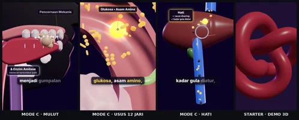

# motion-diorama

**Skill Claude Code open-source untuk memproduksi video edukasi
vertikal 9:16 (30–60 detik; format peta 30–120 detik) bergaya 3D —
diproduksi dari kode** (Remotion + Three.js). Bukan slideshow
gambar AI, bukan footage: visual dibangun sebagai scene 3D per
scene — prosedural secara bawaan, dan khusus format peta memakai
data geografi asli serta model 3D berlisensi terbuka bila
diperlukan — dengan timing yang diukur dari audio narasi aslimu,
bukan tebakan jumlah kata, dan sitasi sumber tampil di layar.

Skill ini adalah sistem produksi nyata yang sudah teruji
memproduksi seri edukasi 3D berbahasa Indonesia, dan dibuka untuk
siapa pun dengan lisensi MIT. Ia dirancang dengan satu prinsip: **periksa sebelum render,
bukan sesudahnya** — timeline divalidasi mesin, setiap tahap
diperiksa terhadap kriteria tertulis sebelum tahap mahal dimulai,
dan sesi wajib QC mandiri sebelum menyerahkan video final.

*Tiga panel pertama: frame dari produksi nyata pertama dengan skill
ini (Mode C — perjalanan nutrisi: mulut, usus dua belas jari, hati).
Panel terakhir: still Demo 3D dari folder `starter/`.*

## Tiga mode video

| Mode | Isi | Contoh topik |
|---|---|---|
| **A — Diorama** | Diorama 3D semi-realistis lanskap/sejarah, termasuk varian peta hidup (satu parameter menggerakkan dunia) | Tembok Besar China, Sundaland, kapal Pinisi |
| **B — Bongkar Benda** | Cara kerja benda/mesin: konteks → zoom → dibongkar → dibelah → menyala → makro mekanisme → prinsip | Rice cooker, mesin jet, AC |
| **C — Anatomi** | Ilustrasi anatomi 3D glossy mengikuti satu aliran (follow-one-flow), kode warna aliran mutlak | Jantung, perjalanan nutrisi, peredaran darah |

## Contoh hasil

- **Produksi nyata pertama** — gambar di atas adalah frame asli
  dari video Mode C “Perjalanan Nutrisi” (Seri Tubuh Manusia
  Part 1, 58,8 detik) yang selesai diproduksi dengan sistem skill
  ini: mulut, usus dua belas jari, dan hati. Panel terakhir adalah
  still komposisi `Demo3D` dari folder `starter/` — bukti scaffold
  yang kamu terima memang bisa dirender.
- **Bahan contoh siap pakai** ada di folder `contoh/`:
  `storyboard-contoh-mode-b.md` adalah storyboard Mode B (rice
  cooker) — bentuk bahan yang kamu siapkan sebelum sesi dimulai;
  `naskah-contoh.txt` adalah naskah narasi pendampingnya (55 kata,
  ±30 detik) — bahan Tahap 1, sebelum direkam menjadi MP3. Sisanya
  (timeline terukur dari audio, scene 3D, QC, file final) dikerjakan
  sesi untukmu.
- Halaman skill ini di direktori skills.sh:
  [skills.sh/wafiq8/motion-diorama](https://www.skills.sh/wafiq8/motion-diorama).
- Catatan jujur: repo ini **belum** menyertakan proyek contoh
  berkode lengkap yang bisa dibedah baris demi baris; yang tersedia
  adalah bahan contoh di atas, bukti frame produksi nyata, dan
  scaffold starter yang terverifikasi. Video-video hasil produksi
  tayang di kanal kreatornya.

## Cara pasang

Pilih satu:

1. **skills CLI** — `npx skills add wafiq8/motion-diorama`
2. **Salin manual** — clone repo ini, lalu salin folder
   `.claude/skills/motion-diorama/` ke folder proyekmu di
   `.claude/skills/motion-diorama/`.
3. **Aplikasi Claude** — unduh folder `.claude/skills/motion-diorama`
   dari repo ini sebagai `.zip`, lalu di aplikasi Claude buka
   **Customize → Skills → + → Upload**.
4. **Plugin Claude Code** — di dalam Claude Code:
   `/plugin marketplace add wafiq8/motion-diorama`, lalu
   `/plugin install motion-diorama@motion-diorama`; skill dipanggil
   sebagai `/motion-diorama:motion-diorama`. Jalur ini sudah diuji
   pembuatnya (Claude Code 2.1.323): marketplace terdaftar, plugin
   terpasang, dan skill-nya ditemukan sebagai komponen plugin.

## Cara pakai

1. Siapkan **storyboard/naskah narasi final** dan **MP3 narasi**
   (30–60 detik — format peta 30–120 — dari TTS pilihanmu — skill ini agnostik suara)
   plus **satu file musik** pilihanmu.
2. Salin isi folder `starter/` ke root repo kerjamu (scaffold
   Remotion yang sudah terverifikasi: `npm install` bersih,
   typecheck lolos, still contoh ter-render), lalu `npm install`.
3. Upload MP3 narasi + musik ke root repo.
4. Buka **sesi Claude Code baru**, tempel isi
   `.claude/skills/motion-diorama/prompt-mulai-sesi-baru.txt`
   yang sudah kamu lengkapi — lembar data itu dibuka dengan
   perintah `/motion-diorama` dan hanya berisi data produksimu;
   semua aturan main hidup di SKILL.md.
5. **Tinggalkan sesi berjalan** — edisi publik memakai **Mode
   Tinggal**: sesi memeriksa timeline dan still-nya sendiri
   terhadap kriteria skill, memperbaiki sendiri temuannya, dan
   berjalan terus sampai video final tanpa menunggu persetujuanmu.
   Ia hanya berhenti bila bahan kurang/rusak atau narasi tidak
   bisa masuk durasi.
6. Unduh `out/<slug>-final.mp4` dari sesi. Laporan akhirnya
   melampirkan contact sheet, daftar penilaian sesi, dan semua
   keputusan otomatis yang diambil (misalnya narasi dipercepat) —
   periksa, lalu minta revisi bila ada yang kurang pas. Mau
   menyetujui timeline & still di tengah jalan? Tulis
   `Mode Tinggal: TIDAK` di prompt.

Contoh siap coba ada di folder `contoh/` (storyboard + naskah
Mode B tentang rice cooker).

## Syarat

- **Claude Code** — memerlukan paket Claude berbayar (paket Free
  tidak termasuk Claude Code), karena sesi harus menulis kode,
  memasang dependensi, dan me-render.
- **TTS sendiri** untuk MP3 narasi (ElevenLabs, Gemini, atau apa
  pun) dan **musik sendiri** — skill tidak memilihkan suara/musik.
- Node.js di lingkungan sesi (sesi cloud Claude Code sudah
  menyediakannya).

## Kustomisasi

- Nama seri, palet, dan detail tiap mode ada di
  `.claude/skills/motion-diorama/references/` — Mode C membawa
  nama bawaan contoh "Seri Tubuh Manusia", ganti dengan serimu.
- Aturan main (durasi, Mode Tinggal, gaya angka, penutup) terkunci di
  `SKILL.md`; ubah dengan sadar bila gayamu berbeda.

## Catatan jujur

Skill ini meniadakan kegagalan yang bisa dicek mesin (timing,
teks terpotong, konsistensi gaya, spesifikasi file). Ia **tidak**
menjamin selera — karena itu pemeriksaan tahapnya tidak dibuang,
melainkan dijalankan sesi sendiri (Mode Tinggal) dengan bukti
yang dilampirkan di laporan akhir untuk kamu nilai. Video pertama di repo baru adalah
yang paling lambat (scaffold + model pertama dibangun); video
berikutnya jauh lebih cepat karena semua aset dipakai ulang.

## Lisensi & kredit

MIT — lihat `LICENSE`. Dibuat oleh **Wafiq Abdur Rozaq**.
Pendekatan skill-untuk-produksi-video, skill ini dibangun dari nol dari pengamatan
gaya dan riset terbuka.
